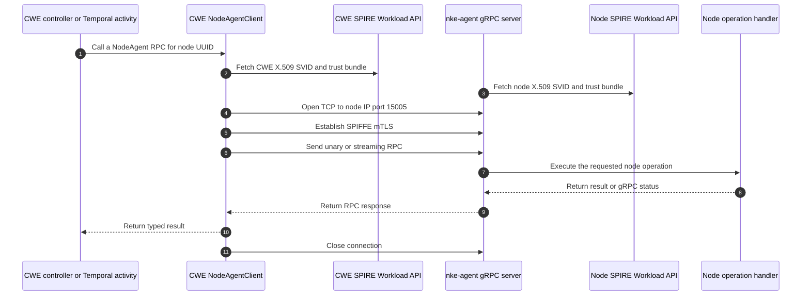
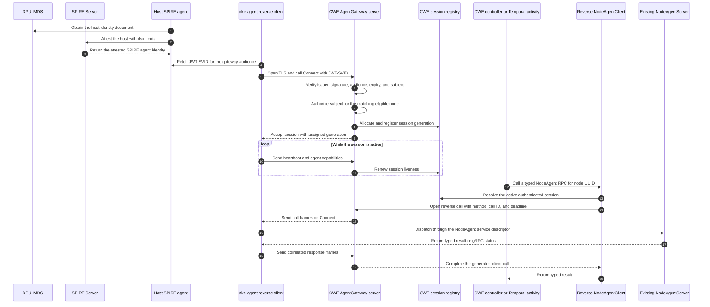
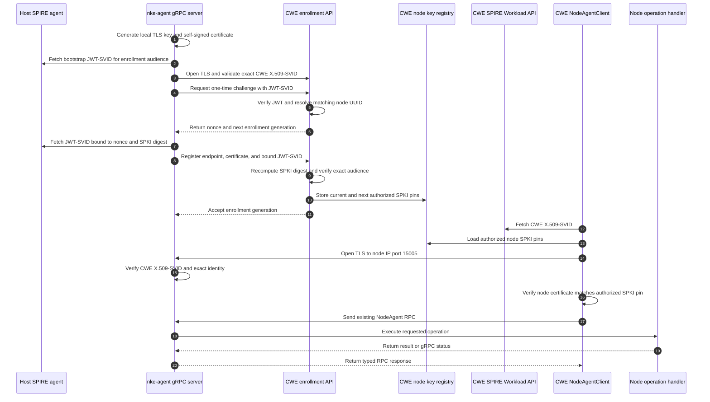

# Node-agent control transport designs

> Status: draft for review

## Problem

CWE currently opens a new gRPC connection to a node's IP address whenever a
controller or Temporal activity calls `nke-agent`. This requires every managed
node to accept inbound TCP connections from the site controller cluster on port
`15005`. It also ties node-agent reachability to routable node addresses and
site firewall rules even though nodes can initiate outbound connections to the
site controller.

In the DPU IMDS environment, `nke-agent` can obtain a JWT-SVID but cannot obtain
an X.509-SVID for its gRPC serving identity. The transport must authenticate
that JWT-only node without moving orchestration into the agent. CWE must remain
the component that chooses the node operation, supplies the request, applies its
deadline and interprets the result.

The long-term design removes inbound node connectivity by reversing the network
connection. A middle-ground design must also preserve the current transport
roles, where CWE is the gRPC client and `nke-agent` is the gRPC server, for sites
that can continue to route CWE traffic to node port `15005`.

## Solution summary

This document defines two designs:

1. **Middle-ground direct gRPC:** `nke-agent` generates a local TLS key and
   self-signed serving certificate, then uses a JWT-SVID-authenticated enrollment
   call to bind that key to its CWE node record. CWE continues to call the
   existing `NodeAgent` service on port `15005`, verifies the enrolled key, and
   presents its existing X.509-SVID for the node to authenticate.
2. **Future agent-initiated stream:** `nke-agent` opens one long-lived
   bidirectional gRPC stream to a CWE agent gateway. CWE retains its generated
   `NodeAgentClient` call pattern through a reverse-channel adapter that
   implements `grpc.ClientConnInterface`.

In both designs, CWE remains the logical NodeAgent client. The node never
selects an operation. The DPU IMDS node agent uses its JWT-SVID as an
application-layer identity and never uses that JWT as a TLS certificate.

In the future reverse design, CWE is the gRPC server for the outer `Connect`
stream because the node opens the network connection. CWE remains the logical
NodeAgent client because it starts each node operation after the stream is
established.

The future reverse channel uses TLS for server authentication and encryption.
The node agent authenticates with a short-lived JWT-SVID obtained from its local
SPIRE Workload API. The middle-ground direct channel uses the node's enrolled
self-signed certificate for encryption and node-key possession, the JWT-SVID to
authorize that key during enrollment, and CWE's X.509-SVID to authenticate CWE
to the node.

## Architecture sequences

### Before: CWE opens each connection



The current transport is implemented in
`controller/internal/agent/client.go`. The node listener and SPIFFE mTLS server
are implemented in `agent/cmd/agent/main.go`.

### Future: the agent opens a persistent reverse channel



The IMDS interaction belongs to SPIRE node attestation. `nke-agent` does not
call IMDS. It asks the already-attested local SPIRE agent for its workload
JWT-SVID.

### Middle ground: JWT-enrolled node key with direct gRPC



The enrollment request is a short unary HTTPS or gRPC call. It is not a
long-lived control stream. After enrollment, CWE keeps the current network and
gRPC roles: CWE dials the node and starts every operation, while `nke-agent`
listens on port `15005` and executes only authenticated requests.

## Middle-ground direct design

### Trust model

The direct design intentionally combines three different proofs:

| Security property | Credential and verifier |
| --- | --- |
| CWE authenticates the node | The TLS handshake proves possession of the node's private key. CWE accepts the presented public key only when its SPKI SHA-256 digest matches the node's enrolled current or next pin. |
| Node authenticates CWE | CWE presents its existing X.509-SVID as its TLS client certificate. The node validates it against a bootstrapped CWE X.509 trust bundle and one exact configured CWE SPIFFE ID. |
| CWE authorizes enrollment | CWE verifies the node's JWT-SVID and binds its authenticated `/host/<node-uuid>` subject to the submitted SPKI digest and the same database node. |
| Confidentiality and integrity | TLS 1.2 or newer protects enrollment and every direct NodeAgent RPC. |

The node's self-signed certificate is not an identity assertion by itself. It
provides a public key and proves that the TLS peer possesses the corresponding
private key. The JWT-SVID-authorized enrollment gives that key its node identity.

This is mutually authenticated TLS with asymmetric credentials, not SPIFFE
X.509 mTLS on both sides. The node does not need an X.509-SVID to validate CWE's
X.509-SVID. It needs only the public CWE trust bundle and the exact CWE identity
that the bundle is allowed to authenticate.

### Enrollment and identity-to-key binding

For first enrollment, `nke-agent`:

1. Generates a TLS private key and a self-signed serving certificate locally.
   The key is written atomically with root-only permissions and never leaves the
   node. The certificate is valid for server authentication; a URI placed in
   this self-signed certificate is not treated as a SPIFFE identity.
2. Loads a bootstrapped CWE X.509 trust bundle and exact expected CWE SPIFFE ID,
   then opens the CWE enrollment endpoint with server-authenticated TLS. CWE
   presents its X.509-SVID as the server certificate. The node does not present
   a TLS client certificate on this connection.
3. Fetches a JWT-SVID from the local SPIRE Workload API for a fixed enrollment
   audience and uses it to request a one-time challenge. CWE verifies the JWT
   and resolves its subject to the matching node UUID before returning a random
   nonce and the next enrollment generation.
4. Computes the SHA-256 digest of the DER-encoded SubjectPublicKeyInfo from the
   generated certificate and fetches a fresh JWT-SVID for this exact audience:

   ```text
   nke-agent-enrollment:<node-uuid>:<generation>:<nonce>:<spki-sha256>
   ```

5. Sends its listener endpoint, certificate, generation, nonce, and bound
   JWT-SVID to CWE. CWE verifies the JWT issuer, permitted algorithm, signature,
   time claims, exact audience, admitted trust domain, and exact
   `/host/<node-uuid>` subject. It independently derives the node UUID and SPKI
   digest instead of trusting request fields.
6. CWE consumes the one-time nonce and stores the node UUID, generation, SPKI
   SHA-256 digest, and enrollment time. Initial enrollment creates the current
   pin. Renewal adds only the next pin until a direct connection proves it.

The conceptual enrollment API is separate from the `NodeAgent` service:

```protobuf
service AgentEnrollment {
  rpc GetEnrollmentChallenge(GetEnrollmentChallengeRequest)
      returns (GetEnrollmentChallengeResponse);
  rpc RegisterAgentEndpoint(RegisterAgentEndpointRequest)
      returns (RegisterAgentEndpointResponse);
}
```

Both methods require a JWT-SVID. `GetEnrollmentChallenge` requires the fixed
bootstrap audience. `RegisterAgentEndpoint` requires the exact dynamic audience
and consumes the corresponding challenge. The registration request carries the
certificate so CWE can derive its SPKI digest; sending a caller-computed digest
alone would not prove what certificate the agent intends to serve.

The nonce and monotonically increasing generation prevent replay and rollback.
Binding the exact SPKI digest into the signed JWT audience prevents a JWT stolen
from one enrollment exchange from authorizing a different public key. The
enrollment verifier can reuse CWE's core JWT issuer, key, algorithm, and time
validation, but it needs a dedicated exact-audience check for each challenge.

The endpoint is not an arbitrary address supplied by the agent. CWE derives the
dial address from the existing database node record and the configured agent
port, or requires any advertised address to match that record. This prevents an
authenticated node from turning CWE into a network proxy to another endpoint.
Certificates and SPKI digests are public material. Private keys remain local,
and JWT-SVIDs remain in memory and are never persisted or logged.

### Direct mutually authenticated TLS

During normal operation:

1. CWE loads the target node's current and next authorized SPKI pins and obtains
   its own rotating X.509-SVID from the local SPIRE Workload API.
2. CWE opens TLS to the node's database IP and port `15005`, presents the CWE
   X.509-SVID as its client certificate, and verifies that the node certificate
   is currently valid, is usable for server authentication, and has an SPKI
   digest matching one of those pins. The TLS handshake proves possession of
   the pinned private key. DNS name validation is not the node identity check;
   the node UUID-to-pin database binding is.
3. The node requires a client certificate, validates the CWE X.509-SVID chain
   against the bootstrapped bundle, and authorizes one exact configured CWE
   SPIFFE ID. A same-trust-domain or path-prefix match is insufficient for this
   privileged caller.
4. Only after both checks pass does CWE send an existing typed `NodeAgent` RPC.

The node-side TLS shape maps to `tlsconfig.MTLSWebServerConfig`: the server
certificate source is the node's local certificate, while the client bundle
source and exact-ID authorizer validate CWE's X.509-SVID. The bootstrapped bundle
must support rotation with an overlap window and atomic reload. If the local
Workload API exposes the required CWE or federated X.509 bundles independently
of issuing a node X.509-SVID, the node may watch that source instead of a file.
For the current identity template, the expected ID is
`spiffe://<trust-domain>/nke-service/cloud-workflow-engine`; deployments using a
different template must bootstrap that exact value rather than a path pattern.

CWE cannot use its current `grpccredentials.MTLSClientCredentials` path
unchanged because that path expects the node server certificate to contain an
authorized SPIFFE ID. The middle ground needs transport credentials that still
present CWE's rotating X.509-SVID but use the node record's SPKI pins as the
server verifier. The generated `NodeAgentClient` and all higher-level typed RPC
callers remain unchanged.

### Delta from the current direct connection

Today, `controller/internal/agent/client.go` obtains both an `X509Source` and a
`BundleSource` from CWE's local SPIRE Workload API. It presents the CWE
X.509-SVID and authorizes the exact node identity
`spiffe://<trust-domain>/host/<node-uuid>`. The rollout adapter has the same
transport shape.

Today, `agent/cmd/agent/main.go` obtains an X.509-SVID from the node's local
Workload API and passes the same source as both its server certificate and trust
bundle to `tlsconfig.MTLSServerConfig`. Its client authorizer accepts selected
same-trust-domain service path prefixes during the identity-template migration.

The middle-ground design changes only the underlying direct TLS credentials:

- the node's SPIRE-issued server X.509-SVID becomes its JWT-enrolled local key
  and self-signed certificate
- CWE's exact-node SPIFFE authorizer becomes an exact node-record SPKI-pin check
- CWE continues presenting the same rotating X.509-SVID
- the node's client-certificate check uses a bootstrapped CWE bundle and is
  tightened from service path prefixes to the exact CWE SPIFFE ID

The `NodeAgent` protobuf API, CWE's role as caller, the node listener, and the
existing operation handlers do not change.

### Node certificate renewal

Renewal overlaps the keys so an interrupted rotation does not strand the node:

1. Before expiry, the agent generates a next private key and self-signed
   certificate while continuing to serve the current certificate.
2. It obtains a new challenge and fresh JWT-SVID bound to the next generation,
   nonce, and next SPKI digest.
3. CWE stores the next pin alongside the current pin. At most one current and
   one next pin are accepted, and generations can only increase.
4. After enrollment is acknowledged, the agent atomically switches its listener
   to the next certificate.
5. CWE performs a direct authenticated `GetKubeadmStatus` call using the next
   pin. Success promotes next to current and retires the old pin after a bounded
   overlap period.

An agent restart resumes from the persisted current and next key state. Loss of
the private-key state requires an explicitly guarded recovery enrollment; it
does not reset the database pin merely because a direct TLS connection fails.

CWE's own X.509-SVID continues to rotate through its SPIRE `X509Source`. The
node validates each newly presented CWE certificate against the rotating trust
bundle and exact SPIFFE ID, so CWE certificate renewal does not require a new
node SPKI enrollment.

### Availability and compatibility

The existing `GetKubeadmStatus` readiness probe, gRPC reflection, unary RPCs,
and streaming RPCs continue to use the direct listener. No generic reverse-call
frames, persistent session registry, or cross-replica dispatch path are needed
for this design.

This design preserves the inbound network requirement: CWE still needs
routable access to every node on port `15005`. It solves JWT-only node identity,
encrypted transport, mutual peer authentication, and node certificate rotation.
It does not solve the firewall and reachability problem that motivates the
future reverse stream.

### Direct-design configuration and deployment

The agent needs settings equivalent to:

```text
--connection-mode=listen-enrolled
--node-server-tls-cert=<path>
--node-server-tls-key=<path>
--cwe-enrollment-address=<dns-name:port>
--cwe-x509-bundle=<path>
--cwe-spiffe-id=<exact-cwe-id>
--cwe-enrollment-bootstrap-audience=<audience>
```

Node bootstrap supplies the enrollment address, node UUID, public CWE bundle,
exact CWE SPIFFE ID, and fixed bootstrap audience. It never supplies a private
key or JWT. The agent generates the node key locally and obtains JWT-SVIDs at
runtime through the existing SPIFFE socket. The security of CWE authentication
depends on the integrity of that public bundle and exact ID, so bootstrap writes
them to root-owned files and later bundle updates use an authenticated delivery
path, overlap old and new trust roots, and replace the file atomically.

CWE adds the enrollment endpoint, JWT issuer and JWKS configuration, challenge
storage, current and next node pin fields, and a pin-verifying direct TLS dialer.
Node records select `direct-spiffe`, `direct-enrolled`, or `reverse`; CWE does
not infer the mode by retrying with weaker credentials after authentication
fails.

### Direct-design validation

Unit, integration, and backend coverage must prove:

- enrollment rejects a wrong issuer, algorithm, signature, time claim, subject,
  trust domain, audience, nonce, generation, or SPKI digest
- an expired or consumed challenge and a rollback generation cannot change pins
- CWE rejects a node certificate whose SPKI digest is not the current or next
  pin, even when the certificate is otherwise well formed
- the node rejects a CWE certificate signed by an untrusted bundle or carrying
  any SPIFFE ID other than the exact configured CWE ID
- current-to-next rotation survives agent and CWE restarts and retires the old
  pin only after a successful direct authenticated probe
- an advertised endpoint that differs from the database node address is rejected
- existing unary, client-streaming, and server-streaming NodeAgent RPCs retain
  their typed behavior through the new TLS dialer
- private keys and JWT-SVIDs are not transmitted outside their intended
  protocol fields, persisted in CWE, or written to logs

The remaining sections specify the future agent-initiated stream unless they
explicitly refer to the middle-ground direct design.

## Connection roles

The two roles are intentionally different:

- At the transport boundary, `nke-agent` is the gRPC client and CWE
  `AgentGateway` is the gRPC server for `Connect`.
- At the node-operation boundary, CWE is the `NodeAgent` client. It selects and
  starts every RPC. The agent never chooses an operation from desired state.

The outer stream does not change ownership of cross-node orchestration,
workflow retries, topology decisions, or cluster state. Those remain in CWE.

## Reverse gRPC channel

Add a transport service alongside the existing `NodeAgent` service:

```protobuf
service AgentGateway {
  rpc Connect(stream AgentFrame) returns (stream ControllerFrame);
}
```

The conceptual frame types are:

```protobuf
message ControllerFrame {
  oneof frame {
    OpenCall open_call = 1;
    CallMessage call_message = 2;
    HalfClose half_close = 3;
    CancelCall cancel_call = 4;
    SessionControl session_control = 5;
  }
}

message AgentFrame {
  oneof frame {
    AgentHello hello = 1;
    Heartbeat heartbeat = 2;
    CallHeaders call_headers = 3;
    CallMessage call_message = 4;
    CloseCall close_call = 5;
  }
}
```

Every call frame carries a session generation and call ID. Message frames also
carry a per-call sequence number. `OpenCall` carries the full generated gRPC
method name, allowlisted request metadata, and the caller's deadline. The
allowlist contains NKE-owned tracing and request-correlation keys only. It never
forwards `authorization`, cookies, or the JWT-SVID used to establish the outer
stream. `CloseCall` carries the final gRPC status and trailers.

On the CWE side, `ReverseClientConn` implements the two methods required by
`grpc.ClientConnInterface`:

```go
type ClientConnInterface interface {
    Invoke(ctx context.Context, method string, args, reply any, opts ...CallOption) error
    NewStream(ctx context.Context, desc *StreamDesc, method string, opts ...CallOption) (ClientStream, error)
}
```

The generated `NewNodeAgentClient` therefore remains the client presented to
rollout operations and new controller code. Existing higher-level methods in
`controller/internal/agent.Client` also continue to return their current typed
responses.

The adapter explicitly supports the call options used by generated and existing
NKE clients, including the static-method marker, response headers and trailers,
message-size limits, and wait-for-ready behavior. It rejects an unsupported
option before sending a frame instead of silently changing its meaning. Peer,
authority override, and per-RPC credential options are not forwarded because
the authenticated outer session already fixes those transport properties.
For wait-for-ready, the registry wakes the call when a matching session arrives
or the caller's context ends. A fail-fast call with no session returns
`Unavailable` immediately.

On the node side, the dispatcher accepts only methods present in the generated
`NodeAgent_ServiceDesc`. It invokes the corresponding handler on the existing
`NodeAgentServer`, preserving the protobuf request and response types and gRPC
status codes. It does not expose a generic method that can invoke arbitrary Go
functions or host commands.

Unary, client-streaming, and server-streaming calls use the same channel.
Per-call sequence numbers and bounded queues isolate each call's ordering and
backpressure. One receive loop demultiplexes frames, and one priority-aware send
loop services bounded control and per-call queues. Heartbeats, cancellation, and
session-control frames take priority over call data, and every frame has a
configured maximum size. A peer that stops reading can still block the whole
HTTP/2 stream, so the session liveness deadline closes that stream and cancels
its calls. Handler execution is bounded independently so a long operation does
not block heartbeats, cancellation, or status calls. Existing
operation-specific mutexes continue to protect node state.

## Identity and TLS

### Host attestation and workload identity

DSX IMDS establishes the host SPIRE agent identity before `nke-agent` starts the
control stream:

1. The DPU `dpu_hw` identity makes the host identity available through IMDS.
2. The host SPIRE agent's `dsx_imds` NodeAttestor obtains that identity and
   attests to SPIRE Server.
3. A workload registration entry beneath the attested host agent selects
   `nke-agent` using its Unix selectors.
4. `nke-agent` uses the Workload API `FetchJWTSVID` operation on the local
   socket and requests a JWT-SVID for the configured CWE gateway audience.

Successful host attestation alone is not sufficient. The workload entry, parent
agent ID, Unix selectors, Workload API socket permissions, audience, and issued
claims must all be verified. The workload entry must exist before the first
connection attempt so registration does not depend on the connection it is
intended to authorize.

The JWT-SVID subject must identify one CWE database node. Preserve the existing
node identity shape when CWE owns the workload registration:

```text
spiffe://<trust-domain>/host/<node-uuid>
```

The gateway derives the node UUID from the verified subject and loads that node
from PostgreSQL. `AgentHello.node_id` must equal the authenticated UUID, but the
unverified hello value never selects the identity or authorization policy.

### JWT-SVID purpose

The JWT-SVID is the node agent's client credential for establishing `Connect`.
It has three bounded uses in the new architecture:

1. **Authentication:** CWE verifies the token and obtains a cryptographically
   authenticated SPIFFE subject for the connecting workload.
2. **Authorization:** CWE maps the verified `/host/<node-uuid>` subject to the
   same node UUID in PostgreSQL and admits a session only when that node exists,
   is eligible, and is configured for reverse connectivity.
3. **Session lifetime:** the token's expiry bounds the lifetime of the accepted
   stream. Reconnection requires a newly fetched JWT-SVID.

The token is checked when the stream is established, not attached to each
NodeAgent call sent later on that stream. It does not act as a TLS certificate,
grant access to unrelated CWE APIs, or authorize the commands CWE sends to the
node. The node authenticates the CWE gateway through its TLS server identity,
and the reverse dispatcher separately limits commands to the admitted
`NodeAgent` method set.

### TLS profile with JWT-SVID client authentication

The agent connects to a stable CWE gateway DNS name using TLS 1.2 or newer and
validates the server certificate against an approved CA bundle. It sends the
JWT-SVID as bearer metadata only when creating `Connect`. CWE validates:

- the exact configured issuer and signing algorithm
- the signature against the issuer's rotating JWKS
- the exact gateway audience
- `exp` and `nbf` with bounded clock skew
- a SPIFFE subject in an admitted trust domain
- the exact `/host/<node-uuid>` path and matching database node
- that the node is not deleting and is configured for reverse connectivity

The JWT is a bearer credential. It must remain in memory, must not be persisted
or logged, and must not appear in connection errors. CWE closes the stream
before token expiry. The node then fetches a new JWT-SVID and reconnects. This
ensures a connection cannot outlive its authenticated credential indefinitely.

JWT-SVID validation can reuse the non-HTTP core of CWE's existing authentication
verifier, including issuer, audience, expiry, algorithm, JWKS refresh, and
SPIFFE-path admission checks. The gRPC interceptor adds the exact node-to-subject
binding.

### Optional future SPIFFE mTLS profile

When the node and CWE trust domains are the same or federated for X.509, the
outer stream uses SPIFFE mTLS. The agent authorizes the exact CWE workload ID,
and CWE authorizes the exact node workload ID. This profile does not also send a
JWT-SVID because mTLS already authenticates both peers with proof of possession.
It is not available to the DPU IMDS node-agent environment described by this
document, where the workload can obtain only a JWT-SVID, and it is not a
prerequisite for either JWT-based design.

Plaintext is limited to local development and tests. Neither production profile
falls back to plaintext when SPIRE, JWKS, or TLS setup fails.

## Session lifecycle

`nke-agent` maintains one connection loop:

1. Wait for networking and the local SPIRE Workload API.
2. Obtain the configured workload credential.
3. Dial the CWE gateway with exponential backoff and jitter.
4. Send `AgentHello` with node UUID, agent version, supported full method names,
   and a connection nonce.
5. Receive the CWE-assigned session generation, then process calls and send
   heartbeats until the stream ends.
6. Cancel all calls tied to the closed session and reconnect with a new
   credential and connection nonce. CWE assigns a new session generation.

CWE accepts one active generation for each node UUID. A newly authenticated
generation replaces and closes the previous generation. Every reverse call is
fenced by the generation it resolved so a response from an old stream cannot
complete work sent on a newer stream.

Heartbeats carry no credential or secret material. Missing the configured
liveness window removes the session from routing and enqueues the node for an
immediate readiness update.

## CWE replica routing

An agent stream terminates on one CWE pod, while a Temporal activity may execute
on another pod. Session ownership therefore cannot be an in-memory map alone.

Each CWE pod exposes an internal dispatch service. On connection, it writes a
session ownership row containing its pod identity and address, node UUID, and
session generation. Each pod renews one pod lease rather than writing every
node heartbeat to PostgreSQL. Node heartbeats update the owner's in-memory
liveness state. Disconnect and timeout remove the ownership row only when its
generation still matches, so an old stream cannot delete its replacement.

Before sending a call, `ReverseClientConn` reads the current owner and requires
both its session row and pod lease to be live:

- Calls owned by the local pod use its in-memory session directly.
- Calls owned by another pod use the internal dispatch service at that pod's
  registered address and include the expected session generation. The owner
  validates that generation against its in-memory stream before dispatch.
- Calls with no live owner return `Unavailable` and do not silently dial port
  `15005` unless the node is explicitly in migration mode.

The internal dispatch hop uses SPIFFE mTLS between CWE workloads. It carries
request data only in memory. Request bodies are not written to PostgreSQL
because NodeAgent requests can contain kubeconfigs, encryption keys, uploaded
files, and other sensitive data.

If the owner pod exits, its lease expires, the agent reconnects through the CWE
Service, and the new owner publishes a new generation. Calls sent to the failed
owner return `Unavailable` and follow the operation's existing retry contract.

## Call completion and retry behavior

The reverse channel does not claim exactly-once execution. A connection can be
lost after the agent starts a mutation but before CWE receives its result, which
is also possible with the current direct unary transport.

- CWE assigns a call ID and preserves the caller's context deadline.
- Context cancellation sends `CancelCall` and cancels the node-side handler
  context.
- The agent returns the original gRPC status code, message, headers, trailers,
  and typed response.
- Async operations continue to use their operation ID and durable node-agent
  status as the retry and recovery boundary.
- Idempotent operations may be retried with the same operation-specific key.
- An operation that is neither idempotent nor durably keyed must not be
  automatically replayed after an unknown delivery outcome.

Every RPC must be classified as read-only, idempotent, operation-keyed, or
non-replayable before it is enabled on the reverse channel. This classification
is enforced by an allowlist in the node dispatcher and covered by tests.

## Capability discovery

The current rollout path probes gRPC reflection on port `15005`. Reflection on
the CWE gateway describes `AgentGateway`, not the connected agent's
`NodeAgent` implementation.

`AgentHello` therefore advertises the generated full method names implemented
by the running agent. CWE records the capabilities with the active session and
uses them for `MethodSupportChecker`. Capability information expires with the
session and is never inferred only from semantic version.

## Readiness

`NodeAgentReady` remains behavioral rather than a TCP-only condition:

1. CWE requires a currently authenticated, non-expired session.
2. The readiness controller calls `GetKubeadmStatus` through the reverse
   `NodeAgentClient` with its existing probe deadline.
3. A successful round trip records `NodeAgentReady=True` and the returned agent
   version.
4. Authentication failure, disconnect, heartbeat expiry, or failed probe records
   `NodeAgentReady=False` with a sanitized reason.

The existing periodic resync remains as recovery for a missed connection event.
A connect or disconnect event also enqueues the node immediately.

## Configuration and deployment

Add agent settings for:

```text
--connection-mode=listen|reverse|dual
--cwe-agent-gateway-address=<dns-name:port>
--cwe-agent-gateway-server-name=<tls-server-name>
--cwe-agent-gateway-ca-bundle=<path>
--cwe-agent-gateway-auth=jwt-svid|spiffe-mtls
--cwe-agent-gateway-jwt-audience=<audience>
--cwe-agent-gateway-spiffe-id=<exact-cwe-id>
```

Only settings for the selected authentication profile are required. The SPIFFE
Workload API continues to use `--spiffe-socket-path`.

The CWE chart adds an agent-gateway container port, Service port, TLS settings,
JWT issuer/JWKS configuration, and an internal dispatch port. Site networking
must permit managed nodes to reach the gateway address. It no longer needs to
permit CWE to initiate connections to every node once migration completes.

Node bootstrap data supplies the gateway address, TLS trust bundle, node UUID,
authentication profile, and audience or expected CWE SPIFFE ID. These values are
configuration and public trust material, not credentials. JWT-SVIDs are always
obtained at runtime through the local Workload API.

## Migration

1. Deploy CWE with the enrollment API, node pin storage, pin-verifying direct
   dialer, and the current SPIFFE direct client. Node records explicitly select
   their direct authentication mode.
2. Release the agent's enrolled-listener mode to JWT-only DPU IMDS nodes. Verify
   enrollment, CWE X.509-SVID authentication, current-to-next pin rotation,
   readiness probes, and real unary and streaming operations while port `15005`
   remains reachable.
3. Operate `direct-spiffe` and `direct-enrolled` nodes as a mixed fleet. Neither
   mode falls back to plaintext or to another authentication mode after a TLS
   or authorization failure.
4. Deploy CWE with `AgentGateway`, reverse session routing, and internal
   dispatch while both direct clients remain enabled.
5. Release `nke-agent` with `dual` mode. It retains the authenticated port
   `15005` listener while establishing the outbound stream.
6. Configure selected nodes as reverse-preferred and verify authenticated
   sessions, capabilities, readiness probes, unary calls, streaming calls, and
   reconnect behavior. Direct dialing is available only because the node is
   explicitly in migration mode.
7. Roll out reverse-preferred mode across the fleet, then change nodes to
   `reverse`, remove inbound port `15005` from site network policy, and later
   remove the direct clients after the supported mixed-fleet window ends.

## Observability and audit

CWE records bounded metrics for:

- enrollment challenges, accepted registrations, and rejections by bounded reason
- direct TLS failures by pin state and node-captured CWE authorization result
- pending next pins, successful promotions, and expired rotation overlap windows
- active sessions by authentication profile
- successful and rejected connections by bounded reason
- reconnects, heartbeat expiry, and replaced generations
- active reverse calls, latency, cancellations, and status-code class
- calls routed locally or through another CWE replica
- calls rejected by the method replay classification

The node-agent audit log retains the RPC full method, authenticated CWE identity,
call ID, direct pin or reverse session generation, duration, and final status.
It does not log JWTs, protobuf bodies, kubeconfigs, encryption keys, file
contents, or unbounded caller-controlled strings.

## Implementation areas

- `agent/pkg/agent/proto/node_agent.proto`: enrollment API, transport service,
  and frame contracts
- `agent/cmd/agent`: local key lifecycle, enrollment and renewal, exact CWE
  X.509-SVID authorization, and reverse connection lifecycle
- `agent/internal/grpcserver`: NodeAgent descriptor dispatcher and stream adapter
- `controller/internal/agent`: SPKI-pin-verifying direct credentials and
  session-backed `grpc.ClientConnInterface`
- `controller/internal/auth`: reusable JWT verifier wiring for enrollment and
  the reverse gRPC interceptor
- `controller/internal/controllers/nodeagentreadiness`: connection events and
  reverse behavioral probes
- `controller/internal/rollout/adapters/cwe`: shared session-backed dialer and
  capability checker plus the same pin-verifying direct credentials
- `controller/internal/db`: node enrollment generations and current or next
  pins, challenges, session ownership, and lease metadata
- `controller/deploy/charts/cloud-workflow-engine`: external gateway and internal
  dispatch ports, enrollment API, TLS, JWT issuer, and JWKS configuration
- node provisioning and deployment-owned OS profiles: enrollment and gateway
  bootstrap settings, CWE X.509 bundle and exact identity, and the DSX IMDS
  workload registration

Generated protobuf files change only after the proto source is updated and
`make protos` is run.

## Validation

Unit and integration coverage must prove:

- JWT issuer, signature, audience, expiry, subject, and node binding failures are
  rejected before a session is registered
- SPIFFE mTLS accepts only the exact configured peer identities
- a controller uses the generated `NodeAgentClient` over the reverse connection
  for unary, client-streaming, and server-streaming methods
- concurrent calls are correlated correctly and one blocked call does not block
  heartbeats or other calls
- deadlines, cancellation, gRPC status codes, headers, and trailers survive the
  channel
- a new generation replaces the old stream and stale responses are fenced
- heartbeat expiry changes `NodeAgentReady` without waiting for periodic resync
- an agent reconnects after CWE restart, node restart, credential rotation, and
  transient network loss
- a Temporal activity running on a non-owner CWE replica reaches the owner over
  the internal dispatch service
- mixed direct, dual, and reverse nodes preserve the explicitly configured
  migration behavior
- no JWT, kubeconfig, encryption key, uploaded content, or protobuf request body
  is persisted or logged by the transport

Backend qualification must run an actual node lifecycle operation through the
reverse channel and verify the requested result on the node. Establishing the
stream or passing a health probe alone is not behavioral qualification.

## Non-goals

- Moving cluster orchestration or desired-state reconciliation into
  `nke-agent`.
- Letting the agent select or synthesize node operations.
- Using JWT-SVIDs as TLS certificates.
- Persisting NodeAgent request or response bodies in PostgreSQL.
- Removing the direct listener before the mixed-fleet migration completes.
