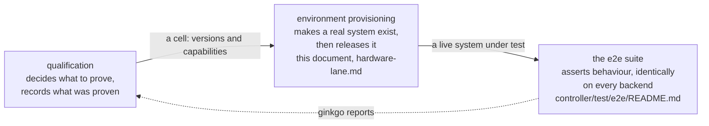

<!--
SPDX-FileCopyrightText: Copyright (c) 2026 NVIDIA CORPORATION & AFFILIATES. All rights reserved.
SPDX-License-Identifier: Apache-2.0
-->

# Release Qualification

## Overview

Qualification asks one question: **do these particular component versions work
together, on real hardware, installed the way a customer installs them?**

It is not the same thing as the e2e test suite, though it uses it. The
difference is what the tests run against.

| | The e2e CI lanes | Qualification |
|---|---|---|
| Machines | none — containers or VMs on the runner | bare metal from an infrastructure provider |
| Site controller | Tilt installs the stack into a Kind cluster | `nkectl bootstrap site`, then the NKE stack from the SBOM |
| Backends | `capd`, `nico-containers`, `nico-vms` | `nico-forge` |
| What it proves | the code is correct | the code is correct **on the path a customer takes** |
| Cost | minutes, free | around 80 minutes, real hardware |

Three concerns, kept apart on purpose, and it is worth knowing which one you
are reading about:

The CI lanes run on every pull request and are where defects are normally
caught. Qualification runs when someone asks, because everything a
Tilt-built cluster proves about the engine, it proves about the engine running
somewhere no customer runs it.

## What a run does

Five steps, each built on the one before:

1. **Provision** a bare machine from Forge — iPXE boot, the OS image under
   qualification written to disk, reachable over the site's jump host.
2. **Bootstrap** a site controller on it: stage `nkectl`, generate a site spec,
   run `nkectl bootstrap site`, install the NKE stack, and confirm the engine
   answers at the expected version.
3. **Create a tenant cluster** through that engine's own API — not through
   Forge directly — so the product's front door is part of what is tested.
4. **Bring up its node pools** on real machines — a CPU control plane and a
   GPU worker — and assert every node reaches Ready.
5. **Install the GPU runtime** into that tenant from public charts and prove a
   CUDA workload runs on it, then tear everything down.

[hardware-lane.md](hardware-lane.md) explains each step and why the awkward
parts are the way they are.

## Naming what is under qualification

The question at the top of this page is about *particular versions*, so saying
which ones is the whole input. That is `-e2e.versions`, a comma-separated set
of `component=version` assignments.

Three components have **no default**, because a run that did not name them has
not said what it is qualifying:

| Key | What it names |
|---|---|
| `controller` | the CWE build, or `built from this checkout` when the workflow compiles it |
| `os-image` | HTTPS URL of the NKE qcow2 the machines boot |
| `os-image-bootloader` | HTTPS URL of the qcow-imager EFI, versioned separately and not derivable from the image |

Omitting one fails the run naming the key, and the error lists the keys that
*were* supplied — which is the common case of a typo in a long assignment
list.

The rest fall back, so a run overrides only what it is changing:

| Key | Default |
|---|---|
| `kube` | `1.36.3` |
| `nke-cni-ovn` | `1.4.0` |
| `spire-agent` | `1.14.1+tpm1.9.0` |
| `nerdctl` | `2.3.5` |
| `kind` | `v0.30.0` |
| `clusterctl` | `v1.12.3` |

**Both image URLs must be plain HTTPS.** iPXE cannot pull an OCI artifact, so
an OCI reference fails at boot rather than at validation.

A labelled `pull_request` run has no inputs to read, so the workflow sources
these from repository variables — `FORGE_E2E_OS_IMAGE`,
`FORGE_E2E_OS_IMAGE_BOOTLOADER` and `FORGE_E2E_STAGE` — and builds the
controller from the checkout. Whatever the source, the run writes what it
actually resolved, and which of those were overridden, to `run-inputs.txt`.
Read that before trusting a result: it is the only artifact that answers "was
this even testing what I thought?"

Capabilities are a separate axis and are not versions. `-e2e.capabilities`
describes the *machine* a run needs; see
[environments.md](environments.md#how-a-machine-gets-chosen).

## Running one

The lane never starts on its own, and it is deliberately not on a schedule or
on push: it costs hardware, and a run nobody is watching is a run nobody acts
on.

It declares two triggers and only one of them works today.

**The label is the live one.** `pull_request: types: [labeled]` against `main`,
so adding `forge-e2e` to a pull request is the request to run. `synchronize`
is deliberately absent, which means pushing to an already-labelled PR does not
quietly take another machine. To run again, remove the label and add it back,
or use the re-run button.

**`workflow_dispatch` is declared and not yet usable.** Dispatch reads a
workflow's definition from the default branch, and this file is not on `main`
yet, so it cannot be dispatched until it merges. Its inputs — the stage, a
controller version, the two image URLs and `keep-site` — are exactly what a
`pull_request` event cannot supply, which is why a labelled run falls back to
`FORGE_E2E_*` repository variables for them.

Either way, one run at a time repository-wide and never cancelled: two
concurrent runs would exhaust the site's capacity, and cancelling one
mid-flight leaks its instance.

`-e2e.site-stage` chooses how far to go, so you can pay for the part you need:

| Stage | Does everything above, plus | Roughly |
|---|---|---|
| `provision` | a Forge node, reachable, then released | 20 min |
| `bootstrap` | vanilla Kubernetes via `nkectl bootstrap site` | 30 min |
| `full` | the NKE stack, the engine, a tenant cluster, and the GPU runtime on it | 80 min |

Only `full` has been measured end to end, at 78 minutes of suite time (82 for
the whole job) on run 36209850156, the first green run with the GPU runtime.
The first green run of all, 36080758381, took 79 (81) before the GPU path
existed. The other two are derived from run 36209850156's own spec
times, where provisioning accounts for about 14 minutes and bootstrap for
another 7, so read them as the right order of magnitude rather than as
observations.

## Reading a result

Every run uploads the same artifacts whether it passed or failed:

| Artifact | What it is |
|---|---|
| `site-e2e.log` | the Ginkgo run |
| `site-e2e.junit.xml` | the same result, machine-readable |
| `run-inputs.txt` | which versions and settings the run actually resolved, and which were overridden |
| `site-diagnostics.tar.gz` | what `nkectl` collected on the node — present only when it failed |
| `tbot.log` | the Teleport bot, for when nothing could be reached at all |

A red run is as likely to be the site as the code. [triage.md](triage.md) is how
to tell the difference without spending an afternoon on it.

## What is qualified today

Stated plainly, because a green run should not be read as more assurance than
it carries.

**Covered.** A site controller built the product way on real hardware at one
site; a tenant cluster created through the engine on that site, with a CPU
control plane and a GPU worker, taken through create and node readiness; the
GPU runtime installed into that tenant from public charts; and a CUDA workload
run on it as an ordinary pod, before everything is deleted.

**Not covered:**

- **GPU breadth.** One GPU type at one site — L40S — with RDMA, MIG and
  GPUDirect deliberately off, and the operator pinned to a version a GPU
  fleet has run rather than to the newest published. A green run says the
  contract holds for that combination, not that it holds generally. See
  [environments.md](environments.md#how-a-machine-gets-chosen).
- **Deeper tenant node-pool behaviour** — replacement, cascade, manual
  scale-down. These specs exist and the simulator lanes run them; the Forge
  lane does not.
- **Site controller upgrade and scale.** The site is a single node, and the
  upgrade specs act on a tenant cluster's control plane.
- **A second site or a second provider.** One site is declared. The
  environment schema cannot yet express a site that attaches by VPC prefix,
  which is where the GB200 capacity lives.

## Where to go next

| Document | Read it when |
|---|---|
| [hardware-lane.md](hardware-lane.md) | you want to know how a run works, step by step, and what it deliberately does not cover |
| [environments.md](environments.md) | you are adding a site, an instance type, or a second infrastructure provider |
| [triage.md](triage.md) | a run went red and you need to know whether it is ours or the site's |

Related, outside this directory:

| Path | Contents |
|---|---|
| `controller/test/e2e/README.md` | running the e2e suite: labels, configuration, and the lane's prerequisites |
| `.github/workflows/forge-site-controller-e2e.yml` | the workflow itself |
| `RELEASE.md` | how a release is cut once a candidate qualifies |
