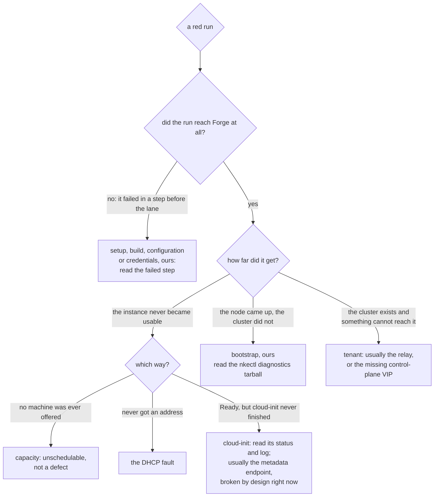

<!--
SPDX-FileCopyrightText: Copyright (c) 2026 NVIDIA CORPORATION & AFFILIATES. All rights reserved.
SPDX-License-Identifier: Apache-2.0
-->

# Triaging a failed hardware run

The first question on a red Forge lane is not "what broke" but **"is this our
defect or the site's?"** Of the first three real runs, two failed on
infrastructure and one on a code defect, and each took hours to tell apart.
This is how to do it faster.

[hardware-lane.md](hardware-lane.md) describes what the lane does. This
describes what to do when it stops doing it.

## Start with the artifacts

The upload runs whether the lane passed or failed (`if: always()`), and carries
whichever of these the run produced:

| Artifact | What it tells you |
|---|---|
| `site-e2e.log` | The Ginkgo run. Start here. |
| `site-e2e.junit.xml` | The same result, machine-readable. |
| `run-inputs.txt` | Which versions, images and settings the run actually resolved — including which were overridden. Answers "was it even testing what I thought?" |
| `site-diagnostics.tar.gz` | What `nkectl` collected **on the node**. Present only when nkectl wrote a diagnostics directory, which it does when it fails. |
| `tbot.log` | The Teleport bot. Only interesting when nothing could be reached at all. |

**An absent `site-diagnostics.tar.gz` is normal and is information.** `nkectl`
writes its diagnostics directory when it fails, so no tarball usually means
bootstrap succeeded and the run failed somewhere after it. The suite
distinguishes this case (`ErrNoDiagnostics`) from a real failure to archive,
because reporting "could not collect diagnostics" for the ordinary case sends
the reader hunting a second fault that does not exist.

## Which step failed

Work down. Each step has a different owner.



Only the bootstrap and tenant branches are usually ours, which is why naming
the step matters more than the stack trace.

**Locate it by spec name, not by job step.** The entire lane is one step —
`Run the site controller lane` — so which step failed tells you almost
nothing. What surrounds it does: the steps before are preparation and the ones
after are cleanup, so a failure in `Check the run is viable` or `Start the
Teleport identity daemon` never reached Forge at all. Inside the lane, the
spec name in `site-e2e.log` is what names the layer:

| Spec | Layer | Usually whose |
|---|---|---|
| `provisions a node` | infrastructure | the site's |
| `reaches what bootstrap and the deploy path pull from` | infrastructure | the site's egress |
| `bootstraps the site controller` | site controller | ours |
| `creates the cluster` | tenant | CWE's, or the site's for the nodes |
| `brings every desired node to Ready` | node pools | either |
| `installs the tenant GPU runtime` | tenant | ours |
| `advertises an allocatable GPU on a worker node` | node pools | the operator's, or the machine's |
| `runs a CUDA workload on a GPU node` | tenant | ours |
| `deletes the cluster` | infrastructure | the site's |

A spec reported `[SKIPPED]` after a failure is not a second fault. The suite
skips what depends on a layer that did not come up, which is why one real
failure can leave most of the run unreported.

### The run never reached the hardware

Symptoms: failure before any instance id appears in the log; `tbot.log`
carries the detail.

Almost always the Teleport join or the bot certificate, not Forge. The runner
joins with the repository's GitHub OIDC token and nothing is stored, so a
failure here is a trust-relationship problem rather than a credential that
expired.

### Provisioning: the instance never became usable

The provider waits twice, and the two waits fail differently.

**`not ready after 30m`** — Forge never brought the instance up, or brought it
up without an address. Ours to report, not to fix.

**`not reachable through <jump host> after 20m`** — Forge says Ready but sshd
never answered. This is the interesting one, because "Ready" means Forge handed
the machine over, not that the image was written and booted. The gap covers
the entire iPXE boot, disk write and first boot.

Read the inner error before blaming the node, though. `ssh: handshake failed:
EOF` together with `relay: ERROR: cannot relogin in non-interactive session`
is Teleport declining the bot's certificate rather than a machine that failed
to boot. Run 36208019553 failed exactly that way against a node Forge had
already reported `BootCompleted`, and the same commit passed thirty minutes
later with nothing changed. `tbot.log` settles it: a healthy daemon logs a
join and then a renewal about every twenty minutes with no errors, so a clean
tbot log alongside that message means the failure was transient and a re-run
is the cheapest next step.

**cloud-init did not finish cleanly** — the node booted and answered, but
`cloud-init status --wait` returned non-zero. The log carries its output. Node
preflight rejects any cloud-init status other than `done`, so the run stops
here deliberately rather than failing later and less clearly.

### The DHCP fault, and how to recognise it

Seen on run 36066151933, tenant control-plane node `cp-4342`, stuck
`Configuring` for over 70 minutes. The signature, from the Serial-over-LAN
console:

- the interface is **up with carrier** — 200Gbps, LLDP peer visible — and has
  **no IP address**;
- `systemd-networkd` logged `Configuring with ...` and then nothing at all;
- `systemd-networkd-wait-online` failed;
- cloud-init could not reach `169.254.169.254` ("Network is unreachable"), fell
  back to `DataSourceNone`, and so set no hostname and installed no packages;
- `kubelet`, `containerd` and `nke-agent` are all `inactive`, and the disk is
  nearly empty.

Carrier up and no address is the tell. That is DHCP, which is the site's, and
no amount of retrying from our side fixes it. File it against Forge with three
things, all of which the diagnostics bundle already contains: the instance id,
the MAC of the interface that got no lease, and the switch its LLDP peer names.
The switch matters most — it is what tells the site which DHCP scope to look
at, and it is the one field an operator cannot reconstruct after the instance
is gone.

Reaching the console at all goes through the site's SSH key group, which
governs Serial-over-LAN and not `authorized_keys`. It gives you a console on a
node you cannot ssh to, which is exactly the case that matters here.

### The FDE lockout, and how to recognise it

Seen on 2026-09-25: tenant control plane
`e2e-nico-forge-20260925-212125-cp-5128`, reporting `Terminating` for four and
a half hours across four delete requests. The signature, again from the
Serial-over-LAN console, is this looping with nothing after it:

```
Success: TPM device /dev/tpm0 ready
Please unlock disk luks-<uuid>:
Nothing to read on input.
cryptsetup: ERROR: luks-<uuid>: cryptsetup failed, bad password or options?
```

The node image roots on LUKS with a single keyslot, sealed to that machine's
own TPM by clevis. There is no passphrase slot and no recovery slot, and
`os-image/docs/full-disk-encryption.md` documents that as deliberate: it is
what makes clearing the TPM between tenants a crypto-erase rather than a
policy. So once the TPM stops unsealing, **no password exists** and the prompt
cannot be answered by anyone. Firmware on these machines orders the local disk
ahead of the network, so the machine never falls through to the iPXE path that
would reimage it — which is the only remediation that doc names.

Two things make this easy to misread.

The instance boots normally first. The case above reached `BootCompleted` at
21:26:10 and ran a full tenant cluster; nothing is wrong until teardown. So a
clean provisioning history is not evidence against this.

And a Forge SOL session follows the **machine**, not the instance. The console
for the case above reported having been connected for three days, which was
before the instance existed. Read the boot timeline off the instance's own
`statusHistory`, not off the console's connection time.

Instances do clear eventually, so this is survivable rather than permanent —
the one above released after about four and a half hours. "Flag and Delete
Instance" in the UI is still worth doing: the delete half will not help, but
the flag puts the machine into maintenance so the next tenant does not land on
a board that cannot unseal its disk. Note that the flag acts on the machine
and is not reachable with a tenant service key, which is why it is a UI action
rather than something the harness can do.

### The metadata endpoint, which is broken by design right now

Since 2026-09-19 new instances cannot reach `169.254.169.254`. The lane works
around it with `phoneHomeEnabled=false`, because phone-home is what normally
flips an instance to Ready and the callback can never complete.

Two consequences when reading a failure:

- An instance that sits in `Provisioning` forever, on a path where we did *not*
  set the flag, is this fault and not a new one.
- Because the flag is off, **Ready no longer implies cloud-init finished**.
  That is why the provider separately waits on `cloud-init status --wait`, and
  why a node can be Ready and useless at the same time.

### Bootstrap: the node came up, the cluster did not

`site-diagnostics.tar.gz` exists. Read it first — it is nkectl's own account of
what it was doing.

The two failure modes worth knowing in advance:

- **An opaque TLS handshake error on every dial.** The node agent's
  `AGENT_ARGS` and `nkectl bootstrap site` disagree about mTLS. They have to
  match: `--disable-mtls` on one requires it on the other.
- **The cluster sits in Provisioning until the timeout, reporting nothing.**
  On the default agent args the agent expects a SPIFFE identity, which it can
  only get if the site spec carries the node's TPM EK thumbprint. Without one,
  nkectl deploys no TPM attestor and the agent never attests.

### Tenant: the cluster was created and something could not reach it

If a tenant spec fails on a dial or a timeout rather than an assertion, check
whether the endpoint relay engaged. A working run logs it:

```
relaying the tenant API server  published="10.91.194.69:6443"  local="127.0.0.1:45011"
```

No such line, plus a timeout dialling a `10.x` address, means the relay did not
run and the runner tried to route to an address only the site can reach. That
was run 36051890151.

## Slow is not the same as hung

Two places where a healthy run looks stuck:

**Delete takes 20 to 40 minutes.** Forge does not release a machine promptly,
and a tenant cluster is not gone until both of its machines are. Two measured
figures: 40.5 minutes on the first green run against a 45-minute budget, and
24.5 minutes on 2026-09-26. Run 36051890151 failed its delete at exactly
1800.306s against a 30-minute budget that was simply too small.

**Past about 40 minutes, though, stop waiting and go look.** `Terminating` is
not evidence of progress. It is what the API reports whether the machine is
releasing normally or is wedged, and the two are indistinguishable from
outside. On 2026-09-25 two of the site's instances reported `Terminating` for
hours, one for over five, and the machine under one of them spent that time
stopped at an initramfs LUKS prompt — see [the FDE lockout](#the-fde-lockout-and-how-to-recognise-it).

**Provisioning takes most of an hour before anything interesting happens.**
Both green `full` runs spent about 78 minutes in the suite and 81 to 82 for
the whole job. A lane that has been
running 20 minutes with a quiet log has not failed.

## Capacity

The site offers 8 `cpu.himem.t1` slots and a `full` run needs 2 of them: the
site node and the tenant control plane. The tenant worker is an L40S, and the
site has 8 of those sitting idle, so himem is the only contended type. A create
that fails immediately with a capacity error, rather than timing out, means
the slots are taken — often by instances from an earlier run that are still
`Terminating`, which is its own reason to care about the section above.

Check before assuming a defect:

```
GET /v2/org/<org id>/forge/instance?siteId=<site id>
```

It returns a bare JSON list, not an object with an `instances` key.

## Before filing against Forge

Have these ready, all of which the artifacts carry:

- the instance id, and the run id;
- which of the two waits failed, and after how long;
- what the console showed, if it was reachable — carrier, address, and whether
  `systemd-networkd` said anything after `Configuring`;
- whether cloud-init reached the metadata endpoint.

A report naming the instance, the MAC and the switch is actionable. "The node
did not come up" is not.
