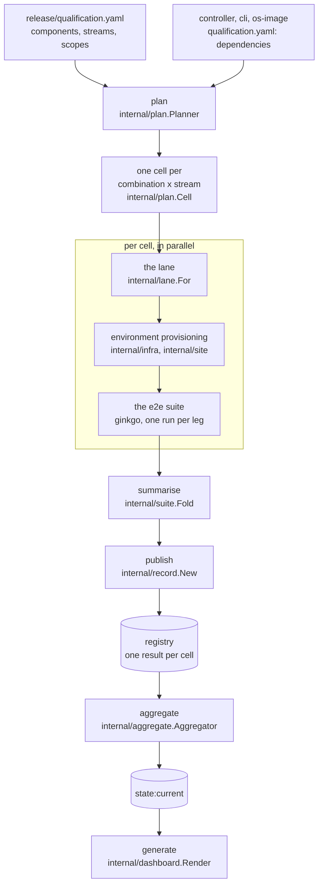
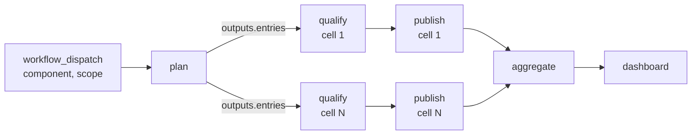
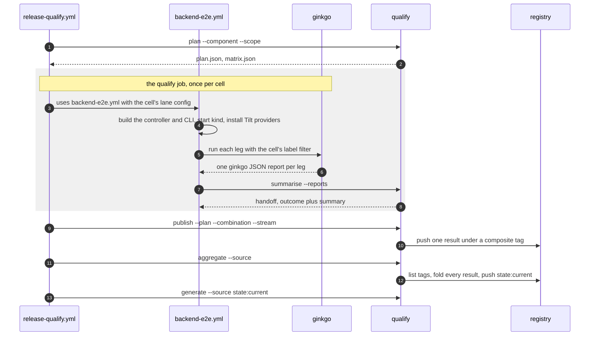
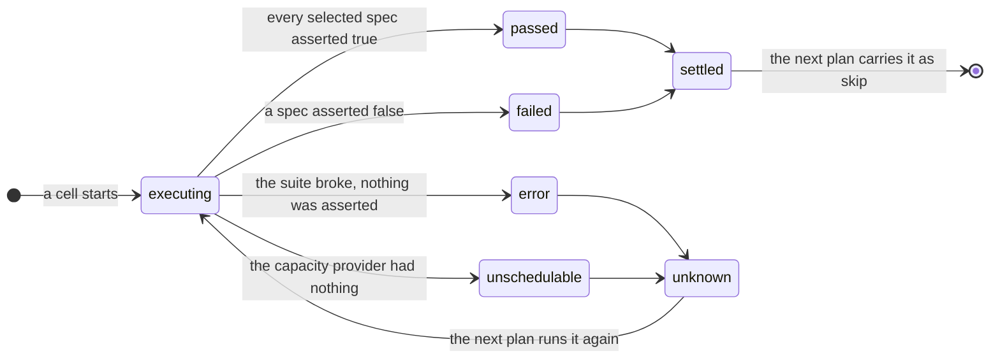
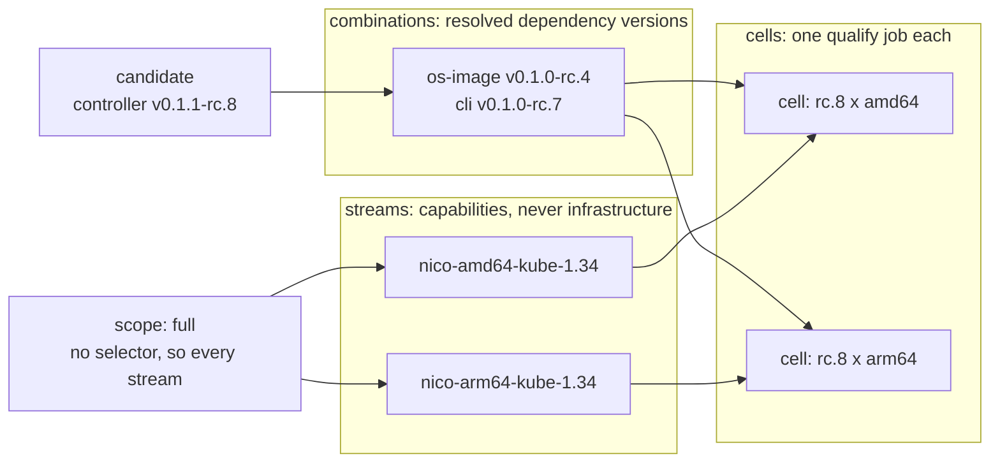
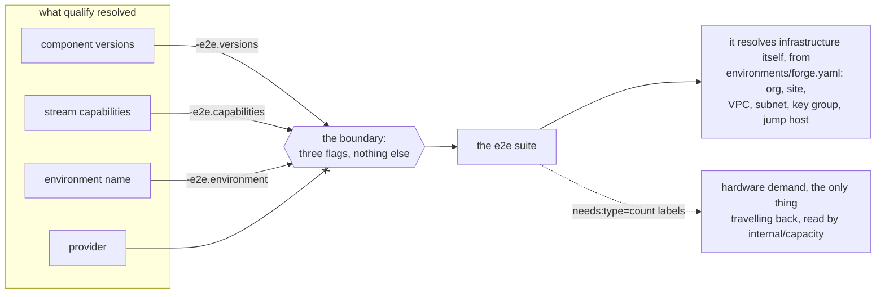
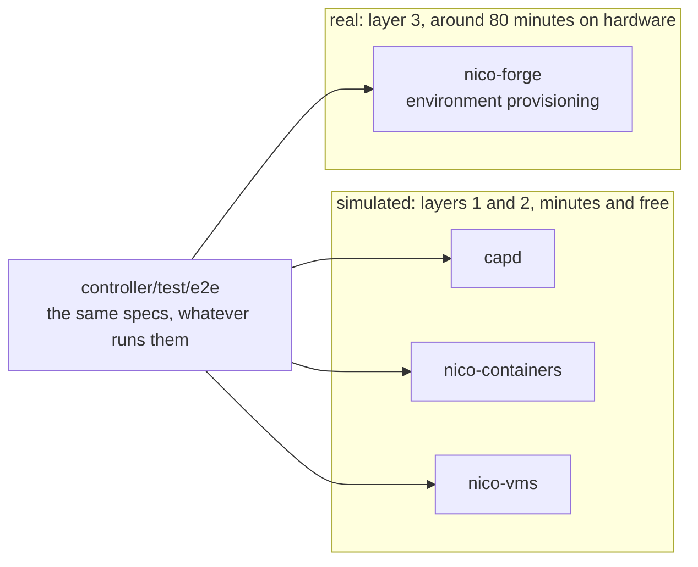

<!--
SPDX-FileCopyrightText: Copyright (c) 2026 NVIDIA CORPORATION & AFFILIATES. All rights reserved.
SPDX-License-Identifier: Apache-2.0
-->

# The qualification workflow

## Overview

Qualification answers one question and publishes the answer: **what was tested
together?**

An NKE release is three independently versioned categories — **Controller**,
**Node** (the agent and OS image, which ship together), and **CLI** — plus an
immutable **compatibility record** naming the exact combination that was
qualified. The categories have always released on their own cadence, and the
tag history shows coordinated releases carrying three different version
numbers. What that history has never recorded is which versions were ever run
against one another. The compatibility record is that missing statement.

```
  candidate combination            qualification              published
  (digests, per category)    ->    (layered evidence)   ->    compatibility
                                                              record
```

The tooling that produces it lives in [`release/`](../../release), and it never
builds anything: it consumes artifacts that already exist, addressed by digest.
That separation is what makes a record meaningful, because a release promotes
the exact bytes that were tested and tooling that can rebuild is tooling that
can substitute. [`release/README.md`](../../release/README.md) covers the
package itself — its layout, its module, and the schema consequences of
"addressed by digest" being harder than it sounds.

## Phases, layers and stages

Three different sequences get described as the "stages" of qualification, and
they are not the same sequence. This document uses each word for exactly one
of them.

| Word | Counts | Defined in | Values |
|---|---|---|---|
| **Phase** | the steps of one qualification run, in order | [`release/cmd/qualify`](../../release/cmd/qualify) | `plan`, `run` or `summarise`, `publish`, `aggregate`, `generate` |
| **Layer** | how much assurance a check can afford, and what it gates | this document | continuous, pre-flight, qualification, governance |
| **Stage** | how far a hardware run goes before it stops | `-e2e.site-stage`, set from the lane's `SITE_STAGE` input | `provision`, `bootstrap`, `full` |
| **Step** | the infrastructure a hardware run stands up, in order | `docs/qualification/hardware-lane.md` | infrastructure, site controller, tenant, node pools, GPU runtime |

The phases are the `qualify` subcommands, which the code calls verbs: verb when
the subject is the CLI surface, phase when it is the order they run in. There
are six subcommands but a run passes through five of them, because `run` and
`summarise` are alternatives rather than consecutive.

The two that get confused are layer and step, because both are ordered and both
build upward. A layer is about *substrate and cost* — what kind of machine a
check runs on and therefore how often it can run. A step is about *dependency*
— a tenant cluster cannot exist before the site controller that serves its API.
Layer 3 is where hardware steps happen at all, so every step lives inside one
layer and the numbering of the two is unrelated.

## The phases of a run

End to end, with the package that owns each piece. Everything in the
highlighted box happens once per cell, and the cells run in parallel:



The registry is the only thing that survives a phase. Read the diagram as
five jobs that happen to run in sequence rather than as a pipeline holding
state, because that is what it is:

| Phase | Job in `release-qualify.yml` | Owned by |
|---|---|---|
| `plan` | `plan` — "Resolve the plan" | [`internal/plan`](../../release/internal/plan), [`internal/policy`](../../release/internal/policy) |
| `run` or `summarise` | `qualify` — one per cell, `uses: backend-e2e.yml` | [`internal/suite`](../../release/internal/suite), [`internal/lane`](../../release/internal/lane), [`internal/capacity`](../../release/internal/capacity) |
| `publish` | `publish` — one per cell | [`internal/record`](../../release/internal/record) |
| `aggregate` | `aggregate` — "Decide what is qualified" | [`internal/aggregate`](../../release/internal/aggregate) |
| `generate` | `dashboard` — "Render the dashboard" | [`internal/dashboard`](../../release/internal/dashboard) |

As a job graph, with the fan-out that makes a matrix:



`publish` carries `if: always()`, which is the whole reason it is a separate
job: a cell whose suite went red still has a result worth recording, and a job
that inherited the failure could not record it. `aggregate` and `dashboard` are
gated on `plan.outputs.publishable` instead, so a dispatch with nothing to
publish stops cleanly rather than pushing an empty state.

```sh
qualify plan      --component controller --scope active --output plan.json --matrix matrix.json
qualify run       --plan plan.json --combination <id> --stream <name> --artifacts ./artifacts
qualify summarise --reports <dir> --conclusion success --combination <id> --stream <name> \
                  --artifacts ./artifacts
qualify publish   --plan plan.json --combination <id> --stream <name> \
                  --artifacts ./artifacts --push <registry>/qualification
qualify aggregate --source <registry>/qualification --state <registry>/qualification/state:current
qualify generate  --source <registry>/qualification/state:current --out ./site
```

Each phase is a separate job in
[`release-qualify.yml`](../../.github/workflows/release-qualify.yml), because
each has a different trigger and a different failure meaning. **The only state
any of them shares is what is in the registry.** There is no database, no
workflow output threaded through five jobs, and no assumption that an earlier
phase ran in the same workflow.

### plan: resolve once

`plan` turns a trigger into a run list. It resolves the dependency versions,
expands the scope into streams, drops what an earlier run already settled, and
writes both a plan and a GitHub Actions matrix.

Every cell in that matrix carries its stream's capabilities rather than just
the stream's name, so the job that executes it is configured entirely from the
plan. Reading the policy again at run time would let an edit that landed
between the plan job and the last cell change what that cell runs — which is
what resolving once is for.

### run, or summarise: two ways a stream executes

These are the same phase split in half, and which one a stream uses depends on
whether its specs need a cluster that does not exist yet.



The `run` path collapses the middle: it invokes ginkgo itself and writes the
same handoff, with no lane involved.

**`run` invokes the suite itself.** It looks the entry up in the plan — never
resolves it — asks the suite what the selection needs with a `--dry-run` over
the same label filter, acquires capacity, runs it, and writes the outcome next
to the report. The two suite invocations build the same command and differ only
by `--dry-run`, so the specs a requirement describes are by construction the
specs that run. A filter selecting no spec is a hard error, because Ginkgo exits
0 on an empty selection and without that check a mistyped filter reports a pass
it never earned.

**`summarise` reads reports the CI lane left behind.** The `nico` streams need
a kind cluster, the Tilt providers, and
`dsx-ai-factory/cluster-api-provider-nico` checked out beside the monorepo. The
last of those is an `actions/checkout` consuming a repository secret, so no Go
process can arrange it for itself.
[`backend-e2e.yml`](../../.github/workflows/backend-e2e.yml) already builds all
three and already accepts a backend, a label filter and a provider list, so
qualification calls it rather than growing a second copy of eleven hundred
lines of cluster setup. A lane runs Ginkgo more than once — the NICo lane has up
to three legs, because controller-managed control planes need a
deployment-wide flag and so need their own run — and `summarise` folds every
leg, because a stream is qualified when everything it selected passed rather
than when its last leg did.

Both paths write the same handoff, so `publish` cannot tell them apart. Which
lane a stream runs in is resolved at plan time, in
[`release/internal/lane`](../../release/internal/lane), and carried in the
matrix: a workflow expression cannot look a provider up in a table, so a wiring
written into CI would apply one provider's lane to every stream whatever its
provider said — running somebody else's specs and recording the result under
this stream's name. A provider with no lane is an error, not a cell.

**The outcome is written before an error is returned**, which is what makes a
failed or unschedulable run publishable. The four outcomes are not
interchangeable:

| Outcome | Meaning | Settled |
|---|---|---|
| `passed` | the suite ran and everything asserted true | yes |
| `failed` | the suite ran and something asserted false | yes |
| `error` | the suite itself broke; nothing was asserted | no |
| `unschedulable` | the hardware was not there | no |

Only `failed` is a qualification result in the sense that it says something
about the candidate. `error` and `unschedulable` leave the answer unknown, so
the next plan runs those streams again.



That loop is the whole reason the outcomes are four rather than two. Collapsing
`error` into `failed` would make a broken runner look like a broken candidate
and then skip it, recording a verdict nobody earned.

### publish: one job per cell

`publish` runs once per cell rather than once after the matrix, so a stream
that failed has a durable result before the rest of the run is over. It is a
separate job from the lane because a matrix job may use `uses:` or `steps:` and
never both, and because the lane holds no credential for the registry.

The tag is composite — version, combination and stream, under the component's
repository — so listing tags says which results exist without pulling any of
them.

### aggregate: decide what qualified means

Nothing before this phase decides it. Each stream published only its own
outcome; `aggregate` folds every result into one artifact and computes what
each candidate is qualified at.

It discovers results from a tag listing rather than being told about them,
which is what makes the central artifact a derived cache rather than a source
of truth. A state that is missing or corrupt simply differs from everything,
and the same code path rebuilds it in full. Coverage follows from which streams
passed rather than from the scope a result claims, so a run that set out to
cover the full matrix and went half unschedulable contributes only what it
proved.

### generate: render it

`generate` renders the aggregated artifact as a static page. It reads the
published state and nothing else, so the page cannot disagree with the record.

## Streams, scopes and combinations

Three words carry the whole matrix, and they are worth keeping straight. The
shape first, with today's actual values:



Multiply, do not add: cells are combinations times streams, so a second
combination doubles the matrix. That is why each dependency carries one
selector today.

A **stream** is one configuration, named by the capabilities it provides —
`{provider: nico, arch: amd64, kube: "1.34"}` — and never by the infrastructure
that satisfies them. Which runner, site or subnet a capability resolves to is
an environment knob belonging to the e2e suite's own config. That boundary is
what keeps the suite runnable by hand and by a second organization, and keeps
this tooling from becoming a config translator.

A **scope** is a named selection over the streams, matched on capabilities.
`full` carries no selector so it matches everything; `active` narrows to the
current minor. The set of supported Kubernetes minors is not declared anywhere
— it is whichever minors have streams — so adding one means adding streams and
nothing else.

A **combination** is one resolved set of dependency versions. A candidate is
qualified against one or more combinations, and each combination against every
stream in the scope. Today each dependency carries the single selector
`latest`, so there is exactly one combination: a controller bump holds the node
image and CLI at their last-qualified versions, which is what makes a failure
name one category instead of three that all moved at once.

`latest` takes the first of three tiers that has a candidate: the highest
release, then the highest *qualified* candidate, then the highest candidate at
all. The third tier is what lets the framework start — on day one nothing has
been qualified, so the tiers above it are empty — and the result is visibly
weaker rather than silently so, because the record says what each held version
had been proven against.

```console
$ go run ./release/cmd/qualify plan --component controller --scope full
{
  "component": "controller",
  "version": "v0.1.1-rc.8",
  "scope": "full",
  "combinations": [
    {
      "id": "os-image-v0.1.0-rc.4_cli-v0.1.0-rc.7",
      "dependencies": [
        { "name": "os-image", "version": "v0.1.0-rc.4" },
        { "name": "cli",      "version": "v0.1.0-rc.7" }
      ],
      "streams": [
        {
          "name": "nico-amd64-kube-1.34",
          "capabilities": { "arch": "amd64", "kube": "1.34", "provider": "nico" }
        },
        {
          "name": "nico-arm64-kube-1.34",
          "capabilities": { "arch": "arm64", "kube": "1.34", "provider": "nico" }
        }
      ]
    }
  ]
}
```

A stream a previous run settled stays in the plan carrying `skip` rather than
being dropped. `passed` and `failed` are both skipped, because rerunning the
same candidate proves nothing either way. Keeping them means a run covering
four of six streams says so instead of looking like a smaller matrix.

Release-wide policy — the components in scope, their streams, and the named
scopes over those streams — lives in
[`release/qualification.yaml`](../../release/qualification.yaml). Each component
says how it is qualified in its own file, next to the code:
[`controller/qualification.yaml`](../../controller/qualification.yaml),
[`cli/qualification.yaml`](../../cli/qualification.yaml),
[`os-image/qualification.yaml`](../../os-image/qualification.yaml). `agent/`
has none, because the agent is built from the same checkout as the OS image and
baked into it, so it is never deployed alone and a run has nothing to select.

## What the suite is told

Three flags carry the whole interface, and
[`controller/test/e2e/internal/qualification`](../../controller/test/e2e/internal/qualification)
is the suite's half of it:

| Flag | Carries |
|---|---|
| `-e2e.versions` | The resolved component versions, as `name=version` pairs |
| `-e2e.capabilities` | The stream's capabilities less `provider`, as `name=value` pairs |
| `-e2e.environment` | The environment config to run against, by name |



`provider` has no arrow across on purpose: it is dropped on the way in because
it selects the label filter and the capacity client, both of which are the
tooling's concern. **No site, subnet or instance identifier crosses this
boundary at all** — the suite resolves those from its own environment file,
which is what lets a second environment with the same capabilities be a config
change rather than a tooling change.

Hardware demand travels the other way, as `needs:<type>=<count>` labels on the
suite's own containers. The requirement is the **maximum** per machine type
across the selected specs rather than the sum, because an `Ordered` container
shares one site controller across every spec beneath it, and summing would ask
for a site's worth of hardware per assertion.

## Qualification layers

Four layers, each doing only what its substrate can afford. Only layers 2 and 3
gate a release; the others exist to make those two cheap and honest.

| Layer | What runs | Substrate | Gates |
|---|---|---|---|
| 1 — Continuous | `controller/test/e2e` emulated lanes | Docker, nico-sim, KVM | Code into `main` |
| 2 — Pre-flight | The same suite, digest-pinned to the candidate | Docker | A candidate, before hardware |
| 3 — Qualification | Lifecycle and conformance suites | Real infrastructure | RC into GA |
| 4 — Governance | Upstream intent drift check | None | Coverage decisions stay explicit |

The rule that keeps the layers from growing into each other: **a check belongs
where its expectation comes from.** "The controller should behave this way" is a
property of the code and belongs in layer 1. "This release pins version X" is a
property of the release and belongs in layer 3, sourced from the SBOM rather
than from a constant in test code.

Layer 2 is the interesting one, and the only layer that does not exist yet. It
runs the existing emulated suite against the candidate's *actual* artifacts,
which today it cannot do, because the lane rebuilds the controller from the
working tree and reads the Kubernetes version from a constant. Closing that
gives a compatibility gate on the artifact set for the cost of an ordinary CI
run, and it catches the failure most likely to bite a release: components that
were never run together.

## Where the hardware lane fits

The specs do not change with the layer. Only the backend underneath them does,
and exactly one backend provisions real machines:



Layer 3 is the only layer that touches real machines, and it is documented
separately because almost everything difficult about it is specific to the
infrastructure rather than to qualification:

| Path | Contents |
|---|---|
| `docs/qualification/overview.md` | What a hardware run proves and what it does not cover yet |
| `docs/qualification/hardware-lane.md` | The steps a run stands up, and why the awkward parts are that way |
| `docs/qualification/environments.md` | Declaring a site, an instance type, or a second provider |
| `docs/qualification/triage.md` | Telling a site fault from a code defect on a red run |

Those arrive with the Forge lane, and are listed by path rather than linked
because they land in a separate change. Note that a hardware run today is
launched from its own workflow and is not yet a stream this workflow plans:
`release/qualification.yaml` declares no `gpu` capability, because today's
streams are container-backed and claiming a capability no lane can back would
be worse than declaring none.

## What a result means today

All six phases run, and `release-qualify.yml` wires them end to end: a dispatch
resolves a plan, runs each cell against the e2e suite, publishes one record per
stream, folds them into a central artifact and renders a page.

**A result does not yet mean the candidate was qualified.** No spec consults
`-e2e.versions`, so a run qualifies what the working tree builds rather than the
candidate the plan named — which is why `BeforeSuite` logs the gap rather than
leaving it to be inferred. In dependency order, what is left:

- [ ] **Honour the versions.** Until this closes, a published record says the
      suite passed against the commit the run was launched from.
- [ ] Carry digests rather than versions in `spec.dependencies`, keeping the
      `digest` versus `contentDigest` split that
      [`release/README.md`](../../release/README.md) describes. The record
      identifies a version set today, not a byte set.
- [ ] Teach the pre-flight lane to accept pre-built artifacts — upstream of
      the release tooling: the build guard, an agent bundle checksum, and a
      configurable Kubernetes version.
- [ ] Add the streams that need real hardware, a Forge provider in
      [`release/internal/capacity`](../../release/internal/capacity), and
      `needs:` labels on the specs that consume it.

## Where to go next

| Document | Read it when |
|---|---|
| [`release/README.md`](../../release/README.md) | you are changing the tooling: its layout, its module, and the record's schema |
| [`controller/test/e2e/README.md`](../../controller/test/e2e/README.md) | you are running the e2e suite directly — labels, configuration and prerequisites |
| [`RELEASE.md`](../../RELEASE.md) | you are cutting a release once a candidate has qualified |
| [`build/README.md`](../../build/README.md) | you are looking for where artifacts come from, which is never here |
