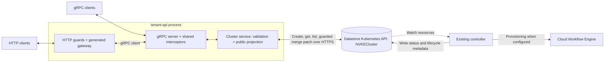

# Stateless tenant API over internal cluster resources

**Status:** proposed
**Date:** 2026-10-14

## Context

The management engine's [internal `NVKECluster`](../../apis/v1/nvkecluster_types.go)
contains desired state, controller bookkeeping, and fields that are not tenant
inputs. The [existing controller](../../controllers/nvkecluster_controller.go)
owns reconciliation. Public clients need a smaller, versioned `Cluster` contract,
snake_case JSON, and generated clients without manually duplicating the internal
schema or acquiring direct access to Kubernetes resources.

## Decision

We will expose an independently deployable, stateless tenant API as an explicitly
selected projection of internal cluster resources, with HTTP and gRPC sharing one
application service and the datastore Kubernetes API remaining authoritative for
admission and persistence.

The diagram shows the runtime connections. Platform ingress is not included.

The [entrypoint](../../cmd/tenant/main.go) composes a
[server shared by both transports](../../internal/public/tenant/server/server.go)
and one [resource service](../../internal/public/tenant/apis/cluster/service.go).
The service owns validation and persistence of permitted desired state. The
generated gateway uses a gRPC client so both transports share the RPC enforcement
path. This provides a common boundary for future caller authentication and
authorization. The controller owns reconciliation, provisioning, and status; the API
[projects stored observations](../../internal/public/tenant/apis/cluster/projection.go)
into the public representation. Persistence does not establish workload readiness.

Public operations and envelopes remain explicitly maintained in
[`cluster.proto`](../../public/tenant/apis/cluster/v1/cluster.proto). The
[exposure policy](../../public/tenant/apis/cluster/v1/exposure.json) selects which
internal spec fields become public; the [compiler](../../hack/public-api/compiler.go)
derives their schemas and mappings from the CRD. Transport bindings are generated
from the public contract. Internal schema growth does not automatically expand
the public interface.

The API process runs independently of the controller. Its storage dependency is
an authenticated Kubernetes API endpoint,
which may be private and served through a platform gateway. Public API ingress
and service-to-datastore access are separate connections. This decision adds no
management-engine datastore proxy and leaves production platform routing unresolved.

Detailed operation semantics, generation ownership, and compatibility rules live
in the [public contract](../../public/tenant/README.md). Process configuration lives
in the [development guide](../../DEVELOPMENT.md#tenant-api-runtime).

## Consequences

- Public contracts can evolve separately from internal resources, but exposure
  and client compatibility still require review. Maintaining a bounded compiler
  replaces the burden of maintaining duplicate schemas and conversions.
- API replicas can scale independently of reconciliation. Datastore availability
  remains necessary for resource operations.  Provisioning runs asynchronously.
- The API holds a datastore credential that public operations do not return.
  The supplied [namespace RBAC](../../config/api/state/identity.yaml) grants
  read/create/patch access to all `NVKECluster` objects in one namespace, with no
  status-write or cross-namespace permissions. Public field restrictions rely on
  the API process. Compromise of that process, or credential theft combined with
  datastore access, could expose internal fields or allow spec/metadata changes
  outside the public contract, within those RBAC and admission limits.
- The MVP serves one deployment-configured namespace without caller authentication or
  authorization and is restricted to isolated evaluation. Production tenant
  isolation requires authorization against verified identity, operation, resource,
  and tenant scope on both transports. Identity-to-storage mapping, operator
  access, and platform gateway integration require separate decisions.

## Options considered

- **Explicit projection with one stateless service:** keeps public field access
  reviewable, derives shared schema details, and leaves lifecycle work with the
  controller.
- **Expose the internal CRD directly:** couples clients to internal evolution and
  grants a broader representation than tenant operations require.
- **Handwrite every public spec and conversion:** avoids a custom compiler but
  duplicates internal types and constraints in the public contract and mappings.
- **Build an additional management-engine datastore proxy:** adds a storage-path
  dependency without a defined responsibility in this MVP. Consuming an existing
  platform gateway remains a separate integration concern.

Revisit the storage boundary if platform connectivity requires mediation,
credential or policy enforcement must be isolated from the API process, or
datastore routing must be owned by an external platform service. Resolving a
tenant to a namespace alone does not require a separate process. A proxy used as
a security boundary must prevent the API from bypassing its enforcement.
