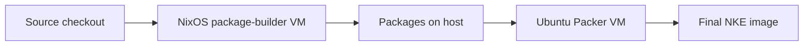

<!--
SPDX-FileCopyrightText: Copyright (c) 2026 NVIDIA CORPORATION & AFFILIATES. All rights reserved.
SPDX-License-Identifier: Apache-2.0
-->

# Build Linux packages with Nix

Nix prepares a Linux VM with the tools needed to build NKE's Debian packages.
Use this on Apple Silicon macOS or when your Linux host differs from the target
architecture. Matching Linux hosts use the existing direct package build by default.

## Build and run

### 1. Install Nix

Follow the [official Nix installation instructions](https://nixos.org/download/)
for your OS. For macOS or Linux with systemd, the multi-user installer is:

```bash
curl --proto '=https' --tlsv1.2 -L https://nixos.org/nix/install | sh -s -- --daemon
```

Open a new terminal and check `nix --version`. If your system already manages Nix
through NixOS or nix-darwin, use that installation.

Add this line to `~/.config/nix/nix.conf` (create the directory/file if needed),
or enable the equivalent setting in your existing NixOS/nix-darwin configuration:

```ini
experimental-features = nix-command flakes
```

**On macOS, the build command bootstraps its own Linux builder when needed.**
Nix first checks the local store and configured binary caches. If Linux builds
remain, the command downloads a standard upstream NixOS guest, starts it,
uses it to prepare the NKE package VM, and shuts it down before package building.
Repeated runs skip that bootstrap VM when the required outputs are already built
or cached. No permanent builder service or system configuration is installed.

That upstream guest must come from the binary cache: no Linux builder exists
yet to build it, so a nixpkgs pin whose `darwin.linux-builder` is uncached
cannot bootstrap. Its host key is nixpkgs' public test key, so it identifies the
guest type but does not authenticate the VM against a local process squatting
its port — the same trade-off as upstream `darwin.linux-builder`.

The initial download needs access to the public Nix cache. On multi-user Nix,
your account must be a **trusted Nix user** to select the temporary builder.
Configure this through your existing Nix/nix-darwin installation; the command
checks permission before starting a VM and does not change it automatically.

Linux hosts retain their existing behavior. A mismatched Linux host still needs
a matching Linux Nix builder or cached custom guest outputs; automatic bootstrap
currently applies to Apple Silicon macOS.

### 2. Build packages

Run from the repository root:

```bash
nix run ./os-image#build-packages-arm64 -- --output "$PWD/artifacts/arm64"
```

Use `build-packages-amd64` for x86 packages. The command starts the VM, copies
in your checkout, builds the packages, copies the results to your output
directory, and shuts down the VM. The first build takes longer; later builds
reuse a persistent disk containing the Nix store and compiler/download caches.
Only the `debs/` subdirectory of the output is the builder's to replace; anything
else already there is left alone.

To check the prerequisites without building anything:

```bash
make -C os-image/packer check-deps ARCH=arm64
```

In Nix mode this realizes the VM runner, which may download the guest closure.
Linux hosts run `nix build --no-link ./os-image#builder-<arch>` and fail right
there, with Nix's own error, when there is no matching Linux builder and no
cache hit. macOS runs `nix run ./os-image#build-packages-<arch> -- --check`,
which bootstraps a temporary Linux builder if the outputs are missing, then
stops without building packages.

### 3. Build the OS image

With the [Packer and image prerequisites](../README.md#build-the-os-image) installed:

```bash
make -C os-image image ARCH=arm64 VARIANT=non-fde
```

This command handles package building automatically; you do not need to run
step 2 first. On a matching Linux host, add `NKE_PACKAGE_BUILDER=nix` to use
the VM explicitly. Use `VARIANT=fde` for an encrypted image.

## Where Nix fits



Nix supplies the builder's tools and starts small shell applications to manage
the VM. The existing Make, Bash, and nfpm package recipes still build the Debian
packages. Packer then installs them into a separate Ubuntu VM to produce the
final image. Neither VM runs another VM.

`os-image/flake.nix` is the Nix configuration; `flake.lock` pins its dependencies.
The builder uses hardware acceleration where available and falls back to QEMU
software emulation. Its compiler produces binaries compatible with Ubuntu.

The persistent disk grows as needed up to 32 GiB and is reused per architecture.
Set `NKE_BUILDER_STATE_DIR` to choose where the disk, keys, and logs live;
the default is `~/.cache/nke/builders/<arch>` (or under `XDG_CACHE_HOME`).
The guest's SSH port is forwarded on `127.0.0.1:5422` for arm64 and `5423` for
amd64, clear of the ports `run-vm.sh`, `boot-smoke.sh` and Packer use. Set
`SSH_PORT` to run another instance.

The runner generates a private SSH host key in that state directory and pins
its public key before connecting. QEMU supplies the private key to the guest
through a systemd credential; sshd reads it from runtime memory, not the Nix
store. All SSH and rsync connections require that pinned key, including the
first boot and boots with a fresh disk. Keep the state directory private.

## How the builder produces Ubuntu-compatible binaries

The guest sets `CC` to `nke-ubuntu-cc`, a wrapper around the pinned nixpkgs
`zig_0_15` C compiler. It targets the guest architecture with the glibc 2.39
ABI (Ubuntu 24.04's baseline, and still compatible with the newer Ubuntu 26.04
used by the Packer recipe), using Zig's bundled libc headers and link stubs.
The result uses Ubuntu's standard dynamic loader and system libc, with no Nix
store RPATH — the Zig dependency supplies the target ABI independently of the
NixOS host's own libc.

The existing agent Makefile honors `CC`, so native `make -C agent deb-arm64`
(or `deb-amd64`) uses this compiler without changing the agent's build rules.
Cgo stays enabled for the agent's dynamic libc dependency; the updater
currently uses no cgo and remains statically linked.
